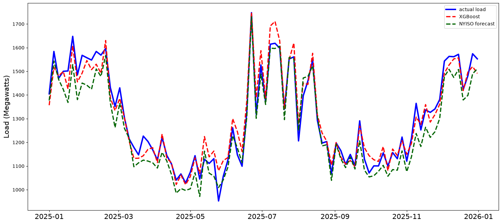
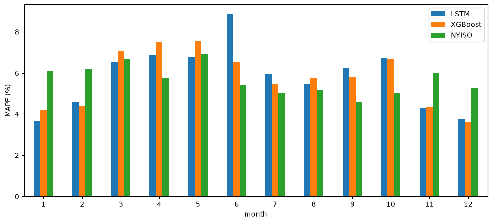

# 纽约州电力负荷预测：XGBoost / LSTM 与 NYISO 官方日前预测对比

用纽约州电网运营商 NYISO 公开的负荷数据和机场气象站观测数据，预测 Capital 区（奥尔巴尼一带）**2025 年全年**的电力负荷，并和 **NYISO 官方的提前一天（day-ahead）预测**在同一批时刻上比较。

**主要结果**：XGBoost 在 2025 年的 MAPE 为 **5.75%**，比朴素基线（10.74%）降低近一半，和 NYISO 官方预测（5.68%）接近。冬季（1、2、11、12 月）比官方预测准约 2 个百分点，3–10 月官方预测更准。LSTM（5.82%）没有超过 XGBoost。



---

## 1. 数据

| 数据 | 来源 | 粒度 | 范围 |
|---|---|---|---|
| 实际负荷 | [NYISO P-58B](http://mis.nyiso.com/public/P-58Blist.htm)（Real-Time Actual Load） | 5 分钟，11 个区域 | 2021–2025 |
| 官方日前预测 | [NYISO P-7](http://mis.nyiso.com/public/P-7list.htm)（ISO Load Forecast） | 1 小时 | 2025 |
| 气象观测 | [Iowa Environmental Mesonet ASOS](https://mesonet.agron.iastate.edu/request/download.phtml)（机场气象站） | 约 1 小时 | 2021–2025 |

建模只用 Capital 区的数据，对应的气象站是奥尔巴尼机场（KALB）。清洗后共 535,027 条 5 分钟级记录。

## 2. 方法

### 2.1 数据对齐与清洗（[03](notebooks/03_combine_data_and_modelling.ipynb)）

- 负荷是 5 分钟一条，气象约 1 小时一条。用最近邻（`NearestNeighbors`）给每条负荷匹配时间上最近的一条有效气象记录。
- 删除气象要素缺失的记录、负荷为空的记录，以及夏令时回拨造成的重复时间戳；合并后重新按时间排序。

### 2.2 特征（共 17 个）

| 类别 | 特征 |
|---|---|
| 气象 | 气温、露点、湿度、气压、风速、降水 |
| 日历 | 星期几、一年中第几天、一月中第几天、一年中第几周、月份、小时、一天中第几分钟 |
| 历史负荷 | `t_m48`：48 小时前同一时刻的负荷；`t_m168`：一周前同一时刻的负荷 |
| 气温累积 | 过去 24 小时、72 小时的平均气温（建筑有热惯性） |

为了和官方预测公平比较，特征只用预测那一刻真的拿得到的信息：

- **不用 24 小时前的负荷。** NYISO 的日前预测在前一天发布，那时还不知道前一天后半天的负荷。
- **滞后负荷找不到时留空值，不回退取当前时刻的负荷。** 回退等于把答案放进了特征里。
- **风向不作为特征。** 它是环形量，359° 和 1° 几乎是同一个方向，数值上却差了 358。

### 2.3 模型

- **朴素基线**：直接用 48 小时前同一时刻的负荷作为预测。
- **XGBoost**：2021–2024 年训练，2025 年测试。只在训练集上用 `TimeSeriesSplit` 做 3 折交叉验证，网格搜索 12 组参数。每一折都是用前面的年份预测下一整年，选出 `max_depth=4`、`learning_rate=0.05`、`min_child_weight=50`，共 300 棵树。
- **LSTM**（[05](notebooks/05_lstm.ipynb)，PyTorch）：
  - 输入数据：取整点数据，补齐成一小时一行的完整网格（2021 年 4 月有整整一周原始数据缺失，插值补上后不让任何训练样本用到它）。
  - 输入特征：每个样本是过去 168 小时的 11 维特征，包括 48 小时前的负荷、4 个气象量，以及小时、星期、年内日期的 sin/cos 编码。
  - 模型和训练：一层 LSTM 加一个全连接层；2021–2023 年训练、2024 年验证，用早停选出 `hidden_size=32`、10 轮；最后用 2021–2024 年全部数据重新训练。

### 2.4 小数据集探索（[02](notebooks/02_exploring_2024_data.ipynb)）

正式建模前，先在 2024 年一年的数据上比较了线性回归、岭回归、GBR 和 XGBoost，并检查了两个容易出错的地方：

- **随机切分会让分数偏乐观**：GBR 的 R² 从按时间切分的 0.837 虚高到随机切分的 0.918。
- **原始特征中的 `tdif` 是用目标负荷算出来的**，属于数据泄漏，已删除。

## 3. 结果（2025 年 8759 个整点，与 NYISO 同一批时刻）

| 模型 | RMSE (MW) | MAE (MW) | R² | MAPE |
|---|---|---|---|---|
| NYISO 官方日前预测 | **93.4** | 74.8 | **0.878** | **5.68%** |
| XGBoost | 95.2 | **69.1** | 0.873 | 5.75% |
| LSTM | 97.5 | 69.7 | 0.867 | 5.82% |
| 朴素基线（48 小时前负荷） | 190.8 | 136.4 | 0.491 | 10.74% |



## 4. 结论

1. **XGBoost 和官方预测基本打平。** 官方预测在 RMSE、R²、MAPE 上略好，XGBoost 的 MAE 更低；两者都远好于朴素基线。
2. **冬季 XGBoost 更准，其余季节官方预测更准。** 1、2、11、12 月 XGBoost 的 MAPE 为 3.6%–4.4%，官方预测为 5.3%–6.2%；3–10 月官方预测每个月都更准。
3. **两者出错的方式不同。**
   - 偏差方向：官方预测全年平均比实际负荷低 43 MW，冬季低 70–80 MW；XGBoost 平均只偏高 8 MW。
   - 误差分布：按小时看，58% 的小时 XGBoost 更接近实际值；但 XGBoost 的大误差更多，偏差超过 200 MW 的小时占 5.9%，官方预测只有 3.1%。这就是 XGBoost 的 MAE 更低、RMSE 却更高的原因。
4. **历史负荷是最重要的特征。** 按增益计算的特征重要性，`t_m48` 约占 0.46，`t_m168` 约占 0.14，之后是气温、露点和 24 小时平均气温。加入 `t_m168` 和两个平均气温后，5 分钟级测试集的 MAPE 从 6.41% 降到 5.74%。
5. **LSTM 没有带来提升。** 它的四个指标都略差于 XGBoost，差距在随机种子带来的波动范围内。XGBoost 训练只要几秒，不需要标准化和补齐时间网格，还能直接看特征重要性，所以这个任务上更合适。

## 5. 局限

- **比较对官方预测不完全公平。** 本项目用的是实测气象数据，而 NYISO 做预测时只能用天气预报。改用天气预报后误差会变大。
- **官方预测整体偏低的原因没有查明。** 可能是两份数据的统计口径不同。
- **范围有限。** 只比较了一个区域、一年的数据；LSTM 只用了一个随机种子，只调了 `hidden_size` 一个参数。

后续可以做的：改用天气预报数据再比一次，扩展到其余 10 个区域，加入节假日特征重点改进 3–10 月，以及对 XGBoost 和 LSTM 的预测做融合。

## 6. 目录与复现

```
notebooks/
├── 01_collect_data.ipynb               下载 NYISO 负荷、官方预测和气象数据，按区域切分
├── 02_exploring_2024_data.ipynb        2024 年小数据集上的多模型探索
├── 03_combine_data_and_modelling.ipynb 2021–2025 数据对齐、特征构造、XGBoost 调参与预测
├── 04_compare_results.ipynb            与 NYISO 官方日前预测对比（整体、按月、按周）
└── 05_lstm.ipynb                       LSTM 建模及三方对比
figures/                                README 中的图
```

按 01 → 05 的顺序运行即可。01 会把原始数据下载到 `data/`（约 1 GB），后续 notebook 生成的中间 csv 都保存在 `notebooks/` 下。原始数据和中间文件都可以重新生成，所以没有上传到仓库。

**环境**：Python 3.13、pandas、scikit-learn、XGBoost、PyTorch 2.14（CPU 即可运行）。

## 致谢

本项目的整体流程（NYISO 数据采集、最近邻对齐天气、日历特征、与官方预测对比）参考了一个公开的 NYISO 负荷预测教程项目（原项目使用 2014–2016 年数据和 GBR）（原项目：https://www.bilibili.com/video/BV1wa4y1S7yL/?spm_id_from=333.1007.top_right_bar_window_default_collection.content.click&vd_source=f86857042c7b05a0fbfe937ca47299a4）。在此基础上做了以下改动：

- **数据**：更换为 2021–2025 年的数据；原项目使用的 Weather Underground 接口已经关闭，改用 IEM 气象数据；
- **修正评估问题**：修正了原项目中的数据泄漏（`tdif`、24 小时滞后特征），改为按时间切分和时间序列交叉验证；
- **新增内容**：增加了一周滞后负荷、平均气温等特征，以及 LSTM 对比和按月、按偏差方向的误差分析。
